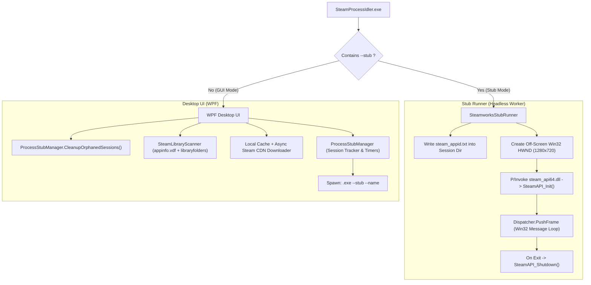

<div align="center">


# SteamProcessIdler

**A modern, lightweight Windows desktop utility for running isolated, virtual Steam game process stubs.**

Simulate official Steam game processes in the background with zero performance overhead, native Discord activity detection, full library discovery, and sandbox isolation.

[](https://dotnet.microsoft.com/download/dotnet/9.0)
[](https://www.microsoft.com/windows)
[](https://learn.microsoft.com/dotnet/core/deploying/single-file/overview)
[](LICENSE)

</div>

---

## Table of Contents

- [Overview](#overview)
- [Key Features](#key-features)
- [Architecture](#architecture)
- [Prerequisites](#prerequisites)
- [Getting Started](#getting-started)
- [Building from Source](#building-from-source)
- [Single-File Publish](#single-file-publish)
- [Safety & Sandbox Guardrails](#safety--sandbox-guardrails)
- [Disclaimer](#disclaimer)
- [License](#license)

---

## Overview

**SteamProcessIdler** is engineered for players, collectors, and developers who want to keep Steam game processes running in the background without installing gigabytes of game assets or wasting CPU/GPU resources.

Whether you want to farm Steam trading cards, keep active play sessions for social status, or test process-dependent integrations, SteamProcessIdler handles process lifecycles safely inside an isolated temporary sandbox.

---

## Key Features

- **Full Steam Library Discovery:**
  - Recursively aggregates game titles from all configured Steam library folders (`libraryfolders.vdf`, `appmanifest_*.acf`), local user configs (`userdata\<id>\config\localconfig.vdf`, `sharedconfig.vdf`), and binary cache (`appcache\appinfo.vdf`).
  - Seamlessly detects owned titles, Free-to-Play games, and shared Steam Family Sharing libraries while filtering out dedicated servers, soundtracks, tools, and DLCs.

- **Smart Executable Heuristics & Custom Overrides:**
  - Evaluates launch configurations in `appinfo.vdf` to prioritize genuine game binaries (e.g. `DeltaForceClient-Win64-Shipping.exe`) over secondary launchers, crash reporters, and updaters.
  - Supports manual game overrides and custom game configurations stored persistently in `%LOCALAPPDATA%\SteamProcessIdler\custom_games.json`.

- **Discord Rich Presence & Activity Detection:**
  - Background stubs instantiate a dedicated off-screen Win32 window (`1280x720`, `Left = -32000`, `Top = -32000`, `HWND`), ensuring external applications like Discord, AMD Adrenalin, and NVIDIA GeForce Experience reliably detect the simulated game as an active running application.

- **100% Icon Coverage (Local & CDN Cache):**
  - Instant discovery of local client icons in `<SteamPath>\steam\games\`, `<SteamPath>\appcache\librarycache\`, and application cache.
  - Automatically fetches missing game icons asynchronously from Valve's official Steam CDN directly into `%LOCALAPPDATA%\SteamProcessIdler\IconCache\`.

- **Hardened Sandbox Isolation:**
  - All process stubs run strictly within `%LOCALAPPDATA%\SteamProcessIdler\Sessions\<AppId>\`.
  - The application **never touches or modifies** original game installation folders (`steamapps\common`).
  - Full path traversal protection (`..` rejection and `Path.GetFullPath()` boundary assertions).
  - Automatic cleanup of temporary session folders on process termination and automatic recovery of orphaned sessions from previous system reboots.

- **Adaptive Windows DWM Title Bar Theme:**
  - Dynamically detects Windows Personalization settings (`AppsUseLightTheme`) via native P/Invoke (`dwmapi.dll` `DWMWA_USE_IMMERSIVE_DARK_MODE`).
  - Live reaction to system theme changes via `SystemEvents.UserPreferenceChanged` (dark title bar in Dark Mode, white title bar in Light Mode).

---

## Architecture

SteamProcessIdler uses a **dual-mode single-executable architecture**:



### 1. GUI Mode (Default)
When launched without arguments, SteamProcessIdler starts the modern Steam-themed dark UI, scans the local Steam library, displays real-time session counters, and provides search, launch, and configuration controls.

### 2. Stub Runner Mode (`--stub <AppId>`)
When launched with `--stub <AppId> [--name "<Title>"]`, the executable runs as a lightweight worker:
1. Replicates directory structures and copies `steam_api64.dll` into the isolated session folder.
2. Generates `steam_appid.txt` matching the target AppID.
3. Creates an off-screen Win32 window (`HWND`) with the game title.
4. Invokes `SteamAPI_Init()` via `steam_api64.dll` to authenticate with the local Steam client.
5. Keeps the message loop alive until closed via GUI or process termination.

---

## Prerequisites

- **Operating System:** Windows 10 (Build 1809 or newer) or Windows 11 (x64)
- **Runtime:** [.NET 9.0 Desktop Runtime](https://dotnet.microsoft.com/download/dotnet/9.0) (if running non-self-contained builds)
- **Steam Client:** Official Steam desktop client installed and running with an active login.
- **Steamworks API Binary:** Requires a 64-bit `steam_api64.dll` binary:
  - SteamProcessIdler automatically searches for and copies `steam_api64.dll` from your local Steam installation.
  - Alternatively, you can place a copy of `steam_api64.dll` directly in the application root directory (available from the official [Steamworks SDK](https://partner.steamgames.com/) or any 64-bit Steam game).

---

## Getting Started

1. Download or publish `SteamProcessIdler.exe`.
2. Ensure Steam is running on your PC.
3. Launch `SteamProcessIdler.exe`.
4. Check the status indicators in the header:
   - **Steam:** Green dot indicates local Steam path found in Windows Registry.
   - **steam_api64.dll:** Green dot indicates the 64-bit API library is ready.
5. Select any game from your library and click **Launch**.
6. The game process will start simulating in the background and appear in your **Active Sessions** list.

---

## Building from Source

Ensure the [.NET 9.0 SDK](https://dotnet.microsoft.com/download/dotnet/9.0) is installed.

```powershell
# Clone the repository
git clone https://github.com/your-username/SteamProcessIdler.git
cd SteamProcessIdler

# Build in Debug configuration
dotnet build SteamProcessIdler/SteamProcessIdler.csproj
```

---

## Single-File Publish

To produce an optimized single-file executable for distribution:

```powershell
dotnet publish SteamProcessIdler/SteamProcessIdler.csproj `
  -c Release `
  -r win-x64 `
  --self-contained false `
  -p:PublishSingleFile=true
```

The resulting standalone executable will be located in:
`SteamProcessIdler/bin/Release/net9.0-windows/win-x64/publish/SteamProcessIdler.exe`

---

## Safety & Sandbox Guardrails

- **Zero Game Modification:** SteamProcessIdler never writes to, deletes from, or modifies any files in your real game installation directories (`steamapps\common`).
- **Temporary Isolation:** Every game session operates inside a quarantined folder in `%LOCALAPPDATA%\SteamProcessIdler\Sessions\<AppId>\`.
- **Automatic Cleanup:** When you click **Stop** or close the application, session directories and temporary stubs are completely removed from disk.
- **Path Traversal Defense:** All input paths are validated against rooted path manipulation and directory climbing sequences (`..`).

---

## Disclaimer

**SteamProcessIdler** is an independent, community-driven open-source utility and is **not affiliated, associated, authorized, endorsed by, or in any way officially connected** with Valve Corporation, Steam, Discord Inc., or any of their subsidiaries or affiliates.

All product names, logos, and brands are property of their respective owners.

---

## License

This project is licensed under the [MIT License](LICENSE).
